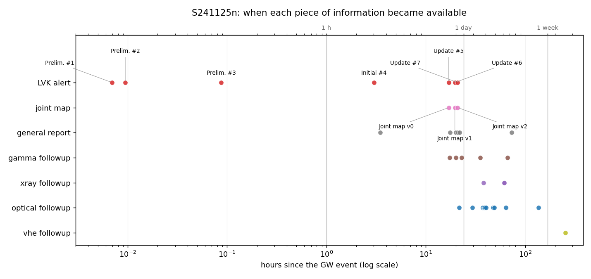
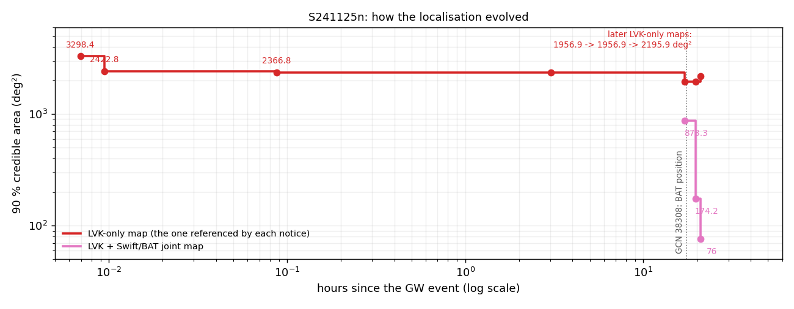
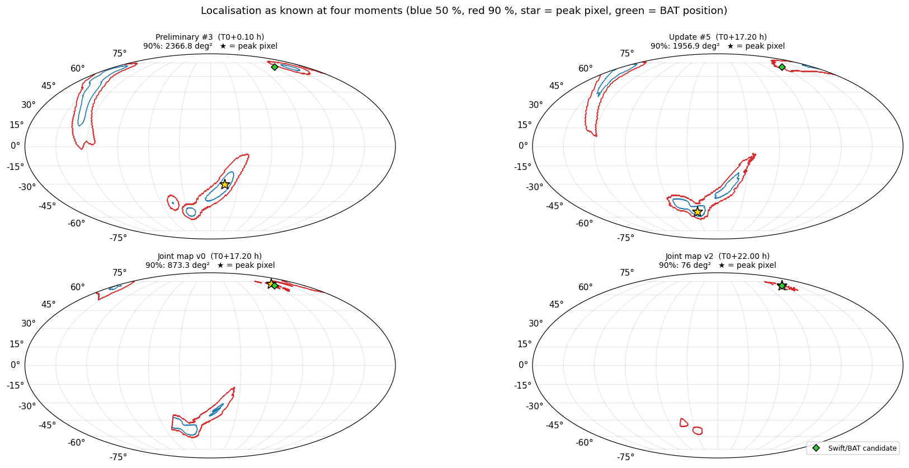
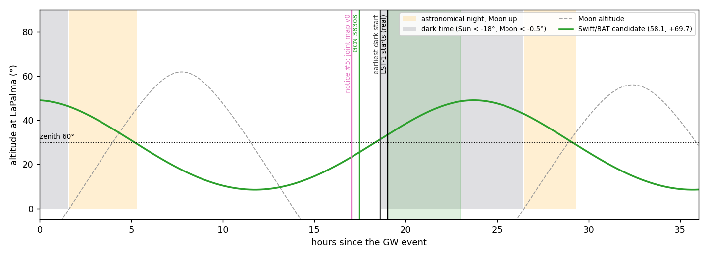
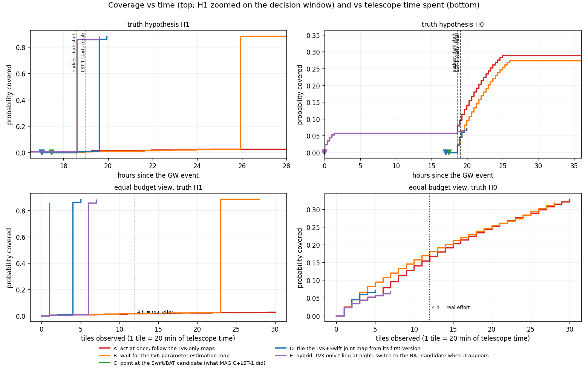
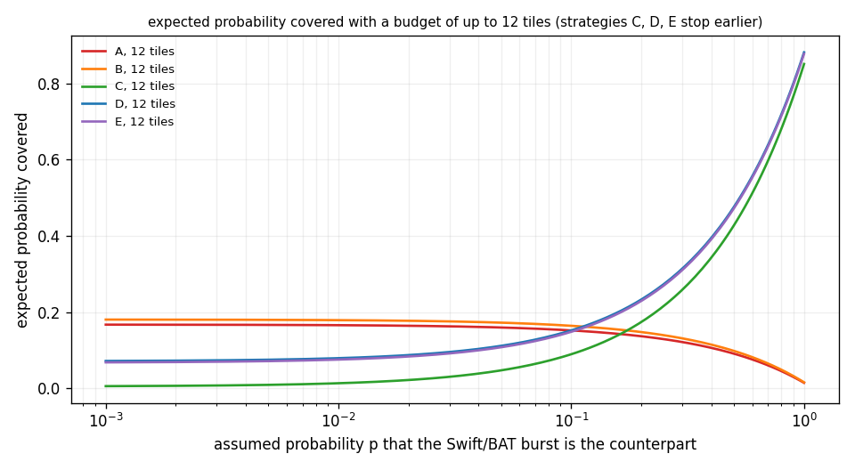
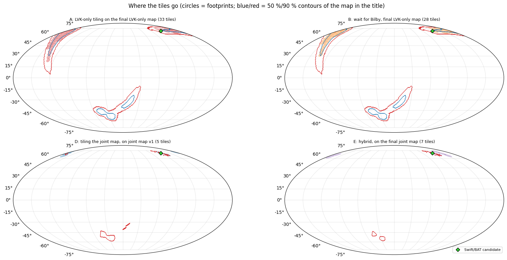
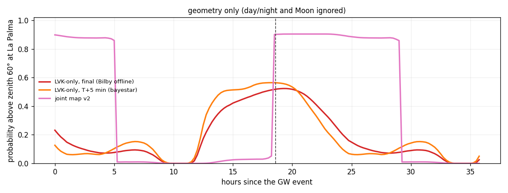
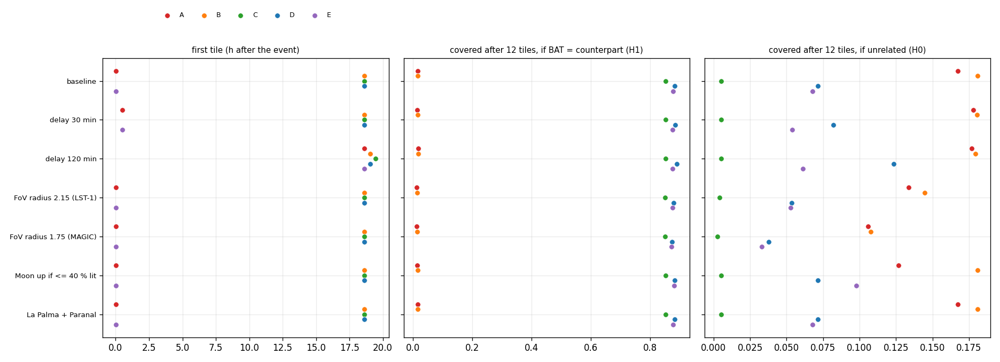

# 回放 S241125n：如果只用当时知道的信息，IACT 该怎么跟进一个引力波警报？
# Replaying S241125n: how should an IACT follow up a gravitational-wave alert, using only what was known at the time?

**最终报告（中英对照）/ Final report (Chinese–English)** · 2026-10-15 · 撰写 / Author：Claude（中立立场 / neutral stance） · 项目 / Project：Rewind the Sky（基于 Astro-COLIBRI / based on Astro-COLIBRI）

> **中文**：这份报告是自包含的：读完它，不需要再看工作区里的其他文件。所有数字都来自项目代码的实际输出，并且核对过；图都在 `figures/s241125n/`。内容与中文版 `FINAL_REPORT_S241125n.md` 相同。
>
> **English**: This report is self-contained: after reading it, there is no need to look at any other file in the workspace. Every number comes from the actual output of the project code and has been checked; the figures are in `figures/s241125n/`. The content is the same as the Chinese version `FINAL_REPORT_S241125n.md`.

---

## 0. 摘要 / Summary

### 中文

**要回答的问题**：2024 年 11 月 25 日，LIGO/Virgo/KAGRA（简称 LVK）探测到一个双黑洞并合 S241125n。它的定位区域大约 2000 平方度，远大于切伦科夫望远镜（IACT）约 20 平方度的视场。17 小时后，Swift 卫星报告了一个可能有关的暗弱伽马暴，位置很准。MAGIC 和 LST-1 随后对准这个位置观测了 4 小时。我们想知道：**只用每个时刻已经公开的信息，能做什么、该做什么？和真实发生的相比如何？**

**做法**：
1. 从一手来源（LVK 通知、GraceDB 天图、NASA GCN 通告）把事件整理成一张"每条信息 + 它第一次能被看到的时刻"的表。
2. 写一个回放引擎，保证在任意时刻 T 只能看到 T 之前的信息。
3. 定义 5 种跟进策略，用 tilepy（Astro-COLIBRI 团队的观测排程软件）为 La Palma 排出具体的观测指向。
4. 在两种假设下给这些指向打分：Swift 暴是这次引力波的对应体（H1），或者两者无关（H0）。

**主要结果**：
1. **限制观测开始时间的是天色，不是决策速度。** Swift 位置在 18:29 UTC 公开；La Palma 最早能观测的时刻是 19:37（天黑，且目标升到足够高）；MAGIC+LST-1 实际在 20:01 开始，只晚了 25 分钟。
2. **对准 Swift 位置，1 个指向（20 分钟）就覆盖了联合定位的 85%。** 铺联合天图要 4 个指向，混合策略要 6 个；只铺 LVK 自己的天图，铺 33 个指向也只有 2.6%。
3. **但这是一个赌注。** 如果 Swift 暴和引力波无关，对准它的策略只覆盖 LVK 天图的 0.5%；而铺 LVK 天图的策略 4 小时能覆盖 17–18%。**只有当你认为"两者有关"的概率高于约 10–17% 时，押 Swift 位置才划算。**
4. **LVK 自己的定位从头到尾没有变好**（3298 → 2196 平方度），而且 La Palma 最多只能看到它的一半左右（52–56%）。
5. **"两者有关"的可信度在三天内被大幅下调**：决策时看到的联合假警报率是"约 250 年一次"，三天后 LVK 改用更合适的算法，变成"约 6 年一次"。

**最重要的局限**：只有一个事件；"覆盖率"是几何量，不等于探测到信号的概率；模型里没有天气，而真实观测约 90% 的数据被云毁掉了；部分策略和指标是在看到初步结果之后才加的（第 9 节）。

### English

**The question**: On 25 November 2024, LIGO/Virgo/KAGRA (LVK) detected a binary black hole merger, S241125n. Its localisation covered about 2000 deg², far larger than the ~20 deg² field of view of an imaging atmospheric Cherenkov telescope (IACT). Seventeen hours later, the Swift satellite reported a faint gamma-ray burst that might be related, with a precise position. MAGIC and LST-1 then observed that position for 4 hours. We ask: **using only the information that was public at each moment, what could have been done, what should have been done, and how does this compare with what really happened?**

**What we did**:
1. Built, from primary sources (LVK notices, GraceDB sky maps, NASA GCN circulars), a table of "each piece of information + the moment it first became visible".
2. Wrote a replay engine that guarantees that at any time T only information from before T can be seen.
3. Defined 5 follow-up strategies and used tilepy (the scheduling software of the Astro-COLIBRI team) to produce concrete telescope pointings for La Palma.
4. Scored these pointings under two hypotheses: the Swift burst is the counterpart of this gravitational wave (H1), or the two are unrelated (H0).

**Main results**:
1. **What limited the start of observations was the sky, not the speed of decision.** The Swift position became public at 18:29 UTC; the earliest possible start at La Palma was 19:37 (dark, and the target high enough); MAGIC+LST-1 actually started at 20:01, only 25 minutes later.
2. **Pointing at the Swift position, a single pointing (20 minutes) covered 85 % of the joint localisation.** Tiling the joint sky map took 4 pointings, the hybrid strategy 6; tiling only the LVK map reached just 2.6 % after 33 pointings.
3. **But this is a bet.** If the Swift burst is unrelated, the strategy that points at it covers only 0.5 % of the LVK map, while tiling the LVK map covers 17–18 % in 4 hours. **Pointing at the Swift position pays off only if you believe the probability that the two are related is above about 10–17 %.**
4. **LVK's own localisation never improved** (3298 → 2196 deg²), and La Palma could see at most about half of it (52–56 %).
5. **The credibility of the association was strongly revised downwards within three days**: at decision time the joint false-alarm rate read "about once in 250 years"; three days later LVK used a more appropriate method and it became "about once in 6 years".

**Most important limitations**: one event only; "coverage" is a geometric quantity, not the probability of detecting a signal; the model has no weather, while about 90 % of the real data was lost to clouds; some strategies and metrics were added after seeing preliminary results (Section 9).

---

## 1. 背景 / Background

### 中文

**Astro-COLIBRI** 是一个天文暂现源警报的汇总平台。引力波、伽马暴、中微子、快速射电暴等的警报都汇到这里，并显示哪个天文台此刻能看到。

**Rewind the Sky**（"倒带天空"）的想法是：把时钟拨回到某个事件刚发生的时刻，**只显示当时已经知道的信息**，然后随时间推进。用途有三个：
- **培训观测者**："现在是事件后 18 小时，你只知道这些，你会怎么做？"
- **比较策略**：同一个事件，不同的跟进方式谁更好？
- **复盘决策**：哪一步本可以做得不同？

**核心难点是"不泄露"。** 数据库里存的通常是最新、最完整的版本：最终定位、最终分类、后来的观测结果。回放时如果不小心用了这些，就会变成"事后诸葛亮"。所以每条信息都必须带上**它第一次能被看到的时刻**，回放引擎也必须能证明自己没有偷看后面的信息。

### English

**Astro-COLIBRI** is a platform that collects alerts on astronomical transients. Alerts on gravitational waves, gamma-ray bursts, neutrinos, fast radio bursts and more arrive there, together with which observatory can see them right now.

The idea of **Rewind the Sky** is to turn the clock back to the moment an event happened, **show only what was known at that time**, and then let time move forward. It has three uses:
- **Training observers**: "It is 18 hours after the event and this is all you know. What do you do?"
- **Comparing strategies**: for the same event, which way of following it up works better?
- **Reviewing decisions**: which step could have been done differently?

**The core difficulty is avoiding leakage.** Databases usually store the latest, most complete version: the final localisation, the final classification, later observations. If a replay accidentally uses these, it turns into hindsight. Each piece of information therefore needs **the moment it first became visible**, and the replay engine must be able to prove that it does not peek at later information.

---

## 2. 为什么选 S241125n / Why S241125n

### 2.1 选择过程 / How it was chosen

**中文**：项目一共做了三个引力波事件：

| 事件 | 特点 | 作为最终案例的不足 |
|---|---|---|
| S250818k（第一个） | 低显著性（71% 可能是噪声），有一个光学候选，后来被证认为超新星 | 没有 IACT 真实观测可对照；数据来自平台，不是一手来源 |
| **S241125n（第二个）** | **双黑洞 + Swift 暗弱暴巧合；MAGIC+LST-1 真实观测过** | — |
| S250206dm（第三个） | 高显著性，月亮 67% 亮，有中微子和 FRB 候选 | 没有 IACT 真实观测 |

选第二个事件时，我在网上找了三个候选，并用 4 次 Astro-COLIBRI 请求核实了数据能不能用：
- **S241125n**：入选。
- **GRB 240612A**：排除。虽然 IACT 用 tilepy 观测过，但平台上它的历史记录是 2025 年 11 月才补录的，时间戳不是当时的，没法回放。
- **S240615dg**：排除。只有 7 篇通告，信息太少。

**English**: The project studied three gravitational-wave events:

| Event | Characteristics | Weakness as the final case |
|---|---|---|
| S250818k (first) | Low significance (71 % likely noise); one optical candidate, later identified as a supernova | No real IACT observation to compare with; data from the platform, not primary sources |
| **S241125n (second)** | **Binary black hole + coincident faint Swift burst; really observed by MAGIC+LST-1** | — |
| S250206dm (third) | High significance, Moon 67 % lit, neutrino and FRB candidates | No real IACT observation |

To choose the second event, I searched the web for three candidates and checked with 4 Astro-COLIBRI requests whether their data were usable:
- **S241125n**: selected.
- **GRB 240612A**: rejected. IACTs did observe it with tilepy, but its history on the platform was back-filled in November 2025, so the timestamps are not the real-time ones and it cannot be replayed.
- **S240615dg**: rejected. Only 7 circulars, too little information.

### 2.2 为什么它最适合做最终案例 / Why it is the best final case

**中文**：
1. **只有它能和真实 IACT 观测对照**：有 MAGIC+LST-1 的论文（arXiv:2607.19972）和他们的 GCN 通告 38443。
2. **它的决策问题正是 CTAO 将来每次都会遇到的**：是铺一大片引力波定位，还是押一个位置很准、但不确定是否相关的候选？
3. **方法最扎实**：全部用一手来源，并和通告、平台、论文逐项交叉核对，有 19 个自动测试。
4. **月亮只有 32% 亮**，月光不会成为主导因素，结论更"干净"。

**English**:
1. **It is the only one with a real IACT observation to compare with**: the MAGIC+LST-1 paper (arXiv:2607.19972) and their GCN circular 38443.
2. **Its decision problem is the one CTAO will face every time**: tile a large gravitational-wave localisation, or bet on a candidate whose position is precise but whose connection is uncertain?
3. **Its method is the most solid**: primary sources only, cross-checked item by item against circulars, the platform and the paper, with 19 automated tests.
4. **The Moon was only 32 % lit**, so moonlight does not dominate and the conclusions are "cleaner".

---

## 3. 事件经过 / What happened

**中文**：事件时刻 T0 = 2024-11-25 01:01:16 UTC。这是一次约 100 倍太阳质量的双黑洞并合，距离 4–6 Gpc。双黑洞通常被认为**不会**发出电磁辐射，所以 Swift 暴是一个"意外的、可能的"关联。

**English**: Event time T0 = 2024-11-25 01:01:16 UTC. It was a binary black hole merger of about 100 solar masses, at 4–6 Gpc. Binary black holes are usually thought **not** to emit electromagnetic radiation, so the Swift burst was an "unexpected, possible" association.

| 事件后 / After T0 | UTC | 发生了什么 / What happened |
|---|---|---|
| +25 s | 01:01:41 | LVK 第 1 个预警：低显著性，56.6% 可能是噪声；90% 区域 3298 平方度 / LVK Preliminary #1: low significance, 56.6 % probability of noise; 90 % area 3298 deg² |
| +34 s | 01:01:50 | 第 2 个预警：另一个分析管线给出**显著**结果（假警报率约 33 年一次），双黑洞；2423 平方度 / Preliminary #2: another pipeline gives a **significant** result (false-alarm rate about once in 33 years), binary black hole; 2423 deg² |
| +5 min | 01:06:30 | 第 3 个预警：2367 平方度 / Preliminary #3: 2367 deg² |
| +3.0 h | | 第 4 个通知（Initial） / Notice #4 (Initial) |
| +3.5 h | | LVK 第一篇通告（GCN 38305） / First LVK circular (GCN 38305) |
| **+17.04 h** | **18:03:24** | **第 5 个通知首次带有"外部巧合"**：Swift 的一个弱触发，附带联合天图 v0（873 平方度），机器可读 / **Notice #5 is the first with an "external coincidence"**: a weak Swift trigger, with joint sky map v0 (873 deg²), machine-readable |
| +17.47 h | 18:29:13 | **GCN 38308**：Swift/BAT 公布候选位置（RA 58.079°，Dec +69.689°，精度约 5 角分） / **GCN 38308**: Swift/BAT publishes the candidate position (RA 58.079°, Dec +69.689°, ~5 arcmin) |
| +17.63 h | | GCN 38309：LVK 通告联合天图 / GCN 38309: LVK circular on the joint sky map |
| **+18.6 h** | **19:37:16** | **La Palma 最早可能开始观测**（天黑，且 Swift 位置升到天顶角 60° 以内） / **Earliest possible start at La Palma** (dark, and the Swift position above zenith angle 60°) |
| **+19.01 h** | **20:01:49** | **MAGIC+LST-1 开始观测**，共 4 小时，云很厚 / **MAGIC+LST-1 start observing**, 4 hours in total, heavy clouds |
| +19.6 / +20.95 h | | 联合天图 v1（174 平方度）、v2（76 平方度） / Joint sky maps v1 (174 deg²) and v2 (76 deg²) |
| +20 to +35 h | | INTEGRAL、Fermi-GBM、Konus-Wind 给出上限 / Upper limits from INTEGRAL, Fermi-GBM, Konus-Wind |
| from +38 h | | Swift-XRT 在 BAT 误差圈里找到 X 射线源 / Swift-XRT finds X-ray sources in the BAT error circle |
| **+73.4 h** | | **GCN 38356：LVK 修正关联显著性的算法**（见 7.4 节） / **GCN 38356: LVK revises how the significance of the association is computed** (Section 7.4) |
| +254.5 h | | GCN 38443：MAGIC+LST-1 报告没有探测到信号 / GCN 38443: MAGIC+LST-1 report no detection |

---

## 4. 实验流程 / Workflow

```
① 下载一手数据 / Download primary data
     GraceDB：7 个 LVK 通知（XML）、8 张天图、日志 / 7 LVK notices (XML), 8 sky maps, logs
     NASA GCN：26 篇通告（JSON） / 26 circulars (JSON)
     Astro-COLIBRI：8 个历史版本（只用于交叉检验） / 8 archived versions (cross-check only)
        ↓
② 建事件日志 / Build the event log
     每条信息 + 它第一次能被看到的时刻（共 44 条） / each item + the moment it first became visible (44 items)
        ↓
③ 核对 / Validate
     面积、时间、位置和通告、平台、论文逐项对比（自动测试） / areas, times, positions vs circulars, platform, paper (automated tests)
        ↓
④ 回放 / Replay
     state_at(T)：只用 T 之前的信息；独立的防泄露检查 / only information before T; independent leak check
        ↓
⑤ 定义策略 / Define strategies
     5 种策略：在哪些时刻、用哪些信息做决定 / 5 strategies: when to decide, and with what information
        ↓
⑥ 排观测 / Schedule
     tilepy 为 La Palma 排出具体的指向和时间 / tilepy produces pointings and times for La Palma
        ↓
⑦ 打分 / Score
     两种假设（H1、H0）下的覆盖率；同等望远镜时间下比较 / coverage under H1 and H0; compared at equal telescope time
        ↓
⑧ 敏感性 / Sensitivity
     每次只改一个设置 / change one setting at a time (reaction delay, field of view, moonlight, sites)
        ↓
⑨ 对照真实 / Compare with reality
     与 MAGIC+LST-1 的实际观测比较 / compare with the actual MAGIC+LST-1 observation
```

**中文**：所有步骤都可以离线重跑，不再消耗 API 额度。

**English**: Every step can be re-run offline without using any API quota.

---

## 5. 方法 / Methods

### 5.1 每条信息"什么时候能被看到" / When each piece of information became visible

| 信息 / Information | 来源 / Source | 取哪个时间 / Time used |
|---|---|---|
| LVK 警报（7 个） / LVK alerts (7) | GraceDB 上的通知原文（XML） / Original notices on GraceDB (XML) | 通知的**分发**时间 / **Distribution** time of the notice |
| 联合天图（3 版） / Joint sky maps (3 versions) | 同一批通知里的"外部巧合"字段 / "External coincidence" field of the same notices | 同一个通知的时间 / Time of that notice |
| 天图 / Sky maps | GraceDB 的天图文件 / GraceDB sky-map files | 引用它的那个通知的时间 / Time of the notice that refers to it |
| GCN 通告（26 篇） / GCN circulars (26) | NASA GCN 归档 / NASA GCN archive | 创建时间，**向上取整到秒**（宁晚不早） / Creation time, **rounded up to the second** (late rather than early) |
| Astro-COLIBRI 记录 / Astro-COLIBRI records | 平台 API / Platform API | **只用来交叉检验**，不进回放（比通知晚 14–22 秒） / **Cross-check only**, not used in the replay (14–22 s later than the notices) |

**中文**：两条值得说明的规则：
- **天图文件比通知早出现时，以通知为准。** LVK 的参数估计图（Bilby）早上 07:06 就上传到了 GraceDB，但要到 18:03 的第 5 个通知才正式发布。自动化系统看到的是发布时间，所以我们用发布时间。这对结果没有影响，因为 07:30–18:15 在 La Palma 是白天。
- **宁晚不早。** 时间有不确定时，取较晚的那个，保证回放不会提前看到信息。

**English**: Two rules deserve a word:
- **When a sky-map file appears before the notice, the notice counts.** LVK's parameter-estimation map (Bilby) was uploaded to GraceDB at 07:06, but only distributed with notice #5 at 18:03. Automated systems see the distribution time, so that is what we use. It has no effect on the results: 07:30–18:15 is daytime at La Palma.
- **Late rather than early.** When a time is uncertain, we take the later value, so that the replay never shows information too early.

### 5.2 回放引擎和防泄露 / Replay engine and leak check

**中文**：`state_at(T)` 只读取时间不晚于 T 的信息，汇总成当时的"快照"：最新警报、最新天图、联合天图、已发布的通告。另有一个**独立的检查函数**：它从头重新算一遍"T 时刻允许看到哪些信息"，只要快照里混进了任何晚于 T 的内容，就直接报错。测试对每一条信息的前 1 秒、当秒、后 1 秒都做了检查。

**English**: `state_at(T)` reads only information timed no later than T and summarises it into a "snapshot": the latest alert, the latest sky map, the joint sky map, the circulars published so far. A **separate check function** recomputes from scratch which information is allowed at time T and raises an error if anything later than T has slipped into the snapshot. The tests check one second before, at, and one second after every single item.

### 5.3 天图处理 / Sky-map handling

**中文**：LVK 的天图格式不统一：有的是多分辨率的，联合天图的像素小到角分级别。为了让排观测和打分看到完全相同的数字，所有天图都转成同一分辨率（HEALPix nside 512，每个像素约 0.1°），转换时总概率不变。面积则用 LVK 自己的工具在原始天图上算，避免小区域被像素放大。

**English**: LVK sky maps come in different formats: some are multi-resolution, and the joint maps have arcminute pixels. So that scheduling and scoring see exactly the same numbers, all maps are converted to one resolution (HEALPix nside 512, pixels of about 0.1°) with the total probability conserved. Areas are computed with LVK's own tool on the original maps, so that small regions are not inflated by the pixels.

### 5.4 观测模拟 / Observation simulation

**中文**：用 **tilepy 3.0.8**，在指定开始时间、天图和望远镜配置下，按"每次选当前能看到的概率最高的位置"排出一串指向。

**English**: **tilepy 3.0.8** produces a sequence of pointings for a given start time, sky map and telescope configuration, each time choosing the visible position with the highest probability.

| 设置 / Setting | 值 / Value | 说明 / Note |
|---|---|---|
| 站点 / Site | La Palma（MAGIC、LST-1 所在地 / site of MAGIC and LST-1） | 敏感性分析里加了 Paranal / Paranal added in the sensitivity study |
| 视场 / Field of view | 圆形，**半径 2.5°** / circle, **radius 2.5°** | 通用值；敏感性里有 LST-1 的 2.15° 和 MAGIC 的 1.75° / generic; LST-1 (2.15°) and MAGIC (1.75°) in the sensitivity study |
| 每个指向 / Per pointing | 20 分钟 / 20 min | |
| 高度限制 / Altitude limit | 天顶角 ≤ 60°（地平高度 ≥ 30°） / zenith angle ≤ 60° (altitude ≥ 30°) | |
| 观测条件 / Observing condition | 暗时：太阳 < −18°，月亮 < −0.5° / dark time: Sun < −18°, Moon < −0.5° | 敏感性里允许亮度 ≤ 40% 的月光 / moonlight up to 40 % illumination in the sensitivity study |
| 时间窗 / Time window | 从决策时刻起最多 2 个夜晚 / up to 2 nights after the decision | |
| 停止条件 / Stop rule | 剩下的位置每个都不到 0.5% 概率时停止 / stop when no remaining position holds ≥ 0.5 % | tilepy 默认 / tilepy default |
| 反应延迟 / Reaction delay | 0（基准） / 0 (baseline) | 敏感性里有 30 和 120 分钟 / 30 and 120 min in the sensitivity study |

**中文**：**重新规划的规则**：新信息到来时，已经开始的指向保留，并告诉 tilepy"这里已经看过"，所以不会重复；还没开始的指向作废，按新信息重新排。同一台望远镜不会被安排在同一时间做两件事。

**English**: **Re-planning rule**: when new information arrives, pointings that have already started are kept and passed to tilepy as "already observed", so they are not repeated; pointings that have not started are dropped and re-planned with the new information. The telescope is never booked for two things at the same time.

### 5.5 五种策略 / Five strategies

**中文**：每种策略是"在哪些时刻、用哪些信息做决定"。决策时刻都是信息第一次公开的时刻。

**English**: Each strategy is "when to decide, and with what information". Decision times are the moments the information first became public.

| 策略 / Strategy | 做法 / What it does | 决策时刻（UTC） / Decision times (UTC) | 用的信息 / Information used |
|---|---|---|---|
| **A** 立刻行动 / Act at once | 一收到警报就铺 LVK 天图，有新天图就更新 / Tile the LVK map as soon as the alert arrives; update with every new map | 01:01:50, 01:06:30, 18:03:24, 21:58:12 | LVK 自己的天图 / LVK-only maps |
| **B** 等精细天图 / Wait for the refined map | 等 LVK 的参数估计图再铺 / Tile once LVK's parameter-estimation map is out | 18:03:24, 21:58:12 | LVK 的 Bilby 天图 / LVK Bilby maps |
| **C** 对准 Swift 位置 / Point at the Swift position | 只观测 Swift 候选位置，**这就是 MAGIC+LST-1 的实际做法** / Observe only the Swift candidate position — **what MAGIC+LST-1 actually did** | 18:29:14 (GCN 38308) | 5 角分的位置 / 5-arcmin position |
| **D** 铺联合天图 / Tile the joint map | 从第一版联合图开始铺，随版本更新 / Tile the joint map from its first version, update with each version | 18:03:24, 20:38:34, 21:58:12 | 联合天图 v0、v1、v2 / joint maps v0, v1, v2 |
| **E** 混合 / Hybrid | 夜里先铺 LVK 天图；看到 Swift 位置就切过去，再跟联合图 / Tile the LVK map at night; switch to the Swift position when it appears, then follow the joint map | 01:01:50, 01:06:30, 18:29:14, 20:38:34, 21:58:12 | 以上都用 / all of the above |

### 5.6 怎么打分 / Scoring

**中文**：
- **两种"真相"假设**，只用来打分，从不用来做决策：
  - **H1**：Swift 暴**就是**这次引力波的对应体。用最终的联合天图（76 平方度）作为真实位置的分布。
  - **H0**：两者**无关**。用 LVK 最终的天图（2196 平方度）。
- **覆盖率**：所有指向的视场合在一起，盖住了"真实位置分布"的多少概率。它是一个几何量。
- **等预算比较**：只看"总覆盖"会误导，因为有的策略排了 33 个指向，有的只排了 1 个。所以主要比较**前 n 个指向**（n = 1、3、6、12）的覆盖。12 个指向 = 4 小时，正好是 MAGIC+LST-1 实际花的时间。
- **期望覆盖和临界概率 p\***：设 p 是"Swift 暴确实是对应体"的概率，那么

  > 期望覆盖 = p × H1 下的覆盖 + (1 − p) × H0 下的覆盖

  p\* 是两个策略期望覆盖相等时的 p。p 高于 p\* 时，利用 Swift 位置的策略更好。

**English**:
- **Two hypotheses about the truth**, used only for scoring and never for decisions:
  - **H1**: the Swift burst **is** the counterpart of this gravitational wave. The final joint sky map (76 deg²) is taken as the distribution of the true position.
  - **H0**: the two are **unrelated**. LVK's final sky map (2196 deg²) is used.
- **Coverage**: how much of the probability of the "true position" lies inside the union of all pointings. It is a geometric quantity.
- **Equal-budget comparison**: total coverage is misleading, because some strategies make 33 pointings and others only 1. The main comparison is therefore the coverage after the **first n pointings** (n = 1, 3, 6, 12). Twelve pointings = 4 hours, exactly the time MAGIC+LST-1 actually spent.
- **Expected coverage and threshold p\***: let p be the probability that the Swift burst really is the counterpart. Then

  > expected coverage = p × coverage under H1 + (1 − p) × coverage under H0

  p\* is the value of p at which two strategies have equal expected coverage. Above p\*, the strategy that uses the Swift position is better.

### 5.7 结果的核对 / Validation

| 核对内容 / Check | 结果 / Result |
|---|---|
| 我们算的 90% 面积 vs LVK 通告 / Our 90 % areas vs LVK circulars | 1957, 873, 174, 2196, 76 deg²：全部吻合 / all agree |
| 同样的面积 vs Astro-COLIBRI 平台 / Same areas vs Astro-COLIBRI | 7 个警报全部吻合（差 < 1.5 平方度） / all 7 alerts agree (difference < 1.5 deg²) |
| 联合天图 v2 的 76 平方度 vs 论文 / 76 deg² of joint map v2 vs the paper | 吻合 / agrees |
| 最终联合图里 Swift 位置附近的概率 vs GCN 38351 / Probability near the Swift position in the final joint map vs GCN 38351 | 0.851 vs "约 / about 84 %"：吻合 / agrees |
| 通知时间 vs GraceDB 日志 / Notice times vs GraceDB log | 差 0 秒 / 0 s difference |
| 观测开始时目标的天顶角 vs 论文 / Zenith angle at the start vs the paper | 我们 57° 和 41°，论文 55° 和 40°，差 ≤ 2° / ours 57° and 41°, paper 55° and 40°, ≤ 2° apart |
| 自动测试 / Automated tests | 本事件 19 个，全项目 45 个，全部通过 / 19 for this event, 45 in the project, all pass |

---

## 6. 结果 / Results

### 6.1 基准设置下的主要数字 / Main numbers (baseline setting)

| 策略 / Strategy | 第一个指向 / First pointing | 指向总数 / Pointings | 前 1 个 / First 1: H1 / H0 | 前 6 个 / First 6: H1 / H0 | **前 12 个（4 小时） / First 12 (4 h): H1 / H0** | H1 越过 50% 需要 / Pointings to exceed 50 % (H1) |
|---|---|---|---|---|---|---|
| A 立刻行动 / Act at once | 0.01 h | 33 | 0.4% / 2.4% | 0.9% / 7.9% | **1.5% / 16.8%** | 达不到（33 个后 2.6%） / never (2.6 % after 33) |
| B 等精细天图 / Wait for refined map | 18.6 h | 28 | 0.4% / 2.5% | 1.0% / 10.8% | **1.6% / 18.1%** | 23（碰巧 / by chance） |
| **C 对准 Swift / Point at Swift** | 18.6 h | **1** | **85.1%** / 0.5% | 85.1% / 0.5% | **85.1% / 0.5%** | **1** |
| D 铺联合天图 / Tile joint map | 18.6 h | 5 | 0.4% / 2.3% | 88.2% / 7.1% | **88.2% / 7.1%** | 4 |
| E 混合 / Hybrid | 0.01 h | 7 | 0.4% / 2.4% | 85.7% / 6.2% | **87.8% / 6.8%** | 6 |

**中文**：C、D、E 的指向不到 12 个，所以"前 12 个"就是它们的全部，只是用的时间更少。

**English**: C, D and E make fewer than 12 pointings, so their "first 12" is everything they did; they simply used less time.

### 6.2 每张图的说明 / Figure-by-figure explanation

#### 图 1 · 每条信息什么时候出现 / Figure 1 · When each piece of information appeared



**中文**

**这张图回答**：信息是在什么时间到来的？

**怎么读**：
- 横轴是事件后的时间，用对数刻度：左边是秒和分钟，右边是天和周。
- 每一行是一类信息：LVK 警报、联合天图、一般通告、伽马、X 射线、光学、甚高能（VHE）。
- 每个点是一条信息第一次能被看到的时刻。

**看到什么**：
- 3 个预警在头 5 分钟内全部发出。之后直到 17 小时，几乎什么都没有，只有 3 小时时的第 4 个通知和 3.5 小时时 LVK 的第一篇通告。
- **决定性的信息全部挤在 17–21 小时**：带外部巧合的第 5 个通知、Swift 的位置通告、三版联合天图。
- 其他仪器的伽马、X 射线、光学结果从约 18 小时开始陆续出现，大多在 MAGIC+LST-1 开始观测（19 小时）**之后**。
- 最右下的黄点是 MAGIC+LST-1 自己的通告，约 10 天后才发出。
- **含义**：MAGIC+LST-1 开始观测时，能读到的通告只有 3 篇（LVK 的识别通告、Swift 的位置、LVK 的联合通告）。他们的观测是对候选位置的"第一次看"，不是在跟进一个已经确认的东西。

**English**

**Question answered**: when did the information arrive?

**How to read it**:
- The horizontal axis is time since the event, on a log scale: seconds and minutes on the left, days and weeks on the right.
- Each row is one kind of information: LVK alerts, joint sky maps, general reports, gamma-ray, X-ray, optical and very-high-energy (VHE) follow-up.
- Each dot is the moment one item first became visible.

**What it shows**:
- The 3 preliminary alerts all came within the first 5 minutes. After that, almost nothing until 17 hours, except notice #4 at 3 hours and LVK's first circular at 3.5 hours.
- **All the decisive information is packed into 17–21 hours**: notice #5 with the external coincidence, the Swift position circular, three versions of the joint map.
- Gamma-ray, X-ray and optical results from other instruments start to arrive around 18 hours, mostly **after** MAGIC+LST-1 began observing (19 hours).
- The yellow dot at the bottom right is the MAGIC+LST-1 circular itself, published about 10 days later.
- **Meaning**: when MAGIC+LST-1 started, only 3 circulars were available (LVK's identification, the Swift position, LVK's joint-map circular). Their observation was a "first look" at a candidate position, not the follow-up of something already confirmed.

#### 图 2 · 定位面积怎么变 / Figure 2 · How the localisation area changed



**中文**

**这张图回答**：定位范围是怎么缩小的？

**怎么读**：
- 纵轴是 90% 可信区的面积（平方度），对数刻度。
- 红线是 LVK 自己的天图，粉线是 LVK 和 Swift 的联合天图。
- 竖虚线是 Swift 位置公布的时刻。

**看到什么**：
- **红线基本是平的**：3298 → 2423 → 2367 → 2367 → 1957 → 1957 → 2196，最后一版反而变大了。
- **粉线在 17–21 小时之间陡降**：873 → 174 → 76。
- **含义**：这个事件里，定位变好**完全来自外部信息**（Swift 的巧合），不是引力波数据本身。

**English**

**Question answered**: how did the localisation shrink?

**How to read it**:
- The vertical axis is the area of the 90 % credible region (deg²), on a log scale.
- Red is LVK's own sky map; pink is the LVK + Swift joint sky map.
- The dashed vertical line is when the Swift position was published.

**What it shows**:
- **The red line is basically flat**: 3298 → 2423 → 2367 → 2367 → 1957 → 1957 → 2196; the last version is even larger.
- **The pink line drops steeply between 17 and 21 hours**: 873 → 174 → 76.
- **Meaning**: in this event, the improvement of the localisation came **entirely from external information** (the Swift coincidence), not from the gravitational-wave data.

#### 图 3 · 四个时刻的天图 / Figure 3 · Sky maps at four moments



**中文**

**这张图回答**：可能的位置在天上哪里？Swift 位置在其中算什么地位？

**怎么读**：
- 全天投影图。蓝线圈出 50% 的概率，红线圈出 90%。
- 黄星是概率最高的那一个像素（**不等于**定位），绿色菱形是 Swift 的候选位置。

**看到什么**：
- **左上（事件后 0.1 小时，第 3 个预警）**：可能的区域分成北边一条长弧和南边一大块，黄星在南边。Swift 位置落在右上角一小片里，很不起眼。
- **右上（17.2 小时，第 5 个通知）**：LVK 天图几乎没变。
- **左下（17.2 小时，联合天图 v0）**：黄星跳到了 Swift 位置，但南边和其他地方还有区域残留。这就是策略 D 比 C 晚 1 小时的原因：它先把这些残留区域扫了一遍。
- **右下（22 小时，联合天图 v2）**：几乎全部概率都集中在 Swift 位置附近，南边只剩两个小圈。
- **含义**：如果只看 LVK 天图，Swift 位置没有任何特别之处；是"它恰好有个暴"这件事，把几乎所有概率都搬到了那里。

**English**

**Question answered**: where on the sky could the source be, and how does the Swift position fit in?

**How to read it**:
- All-sky projections. Blue encloses 50 % of the probability, red 90 %.
- The yellow star is the single most probable pixel (**not** the localisation); the green diamond is the Swift candidate position.

**What it shows**:
- **Top left (0.1 h, Preliminary #3)**: the possible region splits into a long northern arc and a large southern patch; the star is in the south. The Swift position lies in a small patch at the top right and looks unremarkable.
- **Top right (17.2 h, notice #5)**: the LVK map has hardly changed.
- **Bottom left (17.2 h, joint map v0)**: the star jumps to the Swift position, but regions remain in the south and elsewhere. This is why strategy D is one hour later than C: it scans these leftover regions first.
- **Bottom right (22 h, joint map v2)**: almost all the probability is around the Swift position; only two small contours remain in the south.
- **Meaning**: on the LVK map alone, the Swift position is nothing special; it is the fact that a burst happened there that moved almost all the probability to it.

#### 图 4 · La Palma 的天空条件 / Figure 4 · Sky conditions at La Palma



**中文**

**这张图回答**：什么时候能观测 Swift 位置？

**怎么读**：
- 横轴是事件后 0–36 小时，纵轴是从 La Palma 看的地平高度。
- 绿线是 Swift 位置的高度。它的赤纬很高（+69.7°），所以从不落下，只在约 9° 到 49° 之间起伏。
- 横点线是 30° 高度（天顶角 60° 的限制）。
- 灰色是暗时（天黑且月亮在地平线下），浅黄是天黑但月亮在天上，灰虚线是月亮的高度。

**看到什么**：
- **刚发生时（0–5 小时）**，Swift 位置其实在 30° 以上，但那时还没人知道它。而且月亮在约 1.4 小时升起，暗时很快结束。
- **5 到 18.6 小时是白天**。
- **四条竖线从左到右**：联合天图 v0（17.0 小时）→ Swift 位置通告（17.5 小时）→ 最早可能开始（18.6 小时，天黑且目标升过 30°）→ LST-1 实际开始（19.0 小时）。
- **含义**：信息 17.5 小时就到了，但天色要求等到 18.6 小时。真实团队只比这个最早时刻晚 25 分钟。**决策再快也没用，限制观测开始时间的是天色。**

**English**

**Question answered**: when could the Swift position be observed?

**How to read it**:
- The horizontal axis is 0–36 hours after the event; the vertical axis is altitude seen from La Palma.
- The green line is the altitude of the Swift position. Its declination is high (+69.7°), so it never sets and only moves between about 9° and 49°.
- The dotted horizontal line is 30° altitude (the zenith-angle-60° limit).
- Grey is dark time (night with the Moon below the horizon), light yellow is night with the Moon up, the grey dashed line is the Moon's altitude.

**What it shows**:
- **Right after the event (0–5 h)** the Swift position was actually above 30°, but nobody knew about it yet. The Moon also rose at about 1.4 h, ending dark time early.
- **From 5 to 18.6 hours it is daytime.**
- **The four vertical lines, left to right**: joint map v0 (17.0 h) → Swift position circular (17.5 h) → earliest possible start (18.6 h, dark and target above 30°) → actual LST-1 start (19.0 h).
- **Meaning**: the information arrived at 17.5 hours, but the sky forced a wait until 18.6 hours. The real team started only 25 minutes after this earliest moment. **A faster decision would not have helped; the sky set the start time.**

#### 图 5 · 五种策略的比较（核心结果） / Figure 5 · The five strategies compared (core result)



**中文**

**这张图回答**：每种策略覆盖了多少？花了多少时间？

**怎么读**：
- 上面两张：横轴是时间，纵轴是覆盖率，▼ 标出决策时刻。左边按 H1（Swift 暴是对应体）打分，并放大了 16.5–28 小时；右边按 H0（无关）打分。
- 下面两张：横轴是**已经观测的指向个数**，每个代表 20 分钟望远镜时间，这就是同等预算的比较。竖虚线是 12 个指向（4 小时，真实花的时间）。

**看到什么**：
- **左上（H1，按时间）**：
  - C 和 E 都在 18.6 小时跳到约 85%（两条线重叠，C 被 E 盖住）。
  - D 在 19.6 小时才跳上去，因为它先扫了联合天图 v0 的其他区域。
  - B 到 25.9 小时才突然跳到 88%。这是碰巧：它的第 23 个指向本来是为 LVK 天图排的（那个位置只占 LVK 天图 0.6% 的概率），恰好离 Swift 位置 1.6°。
  - A 一直在 2% 左右。
- **右上（H0，按时间）**：
  - A 和 E 在第一夜（0–1.3 小时）排了 5 个指向，拿到约 6%，然后天亮，曲线变平。
  - 第二夜 A 和 B 稳步上升，到图右边界（36 小时）时约 29% 和 27%；算上之后的指向，最终 A 约 35%、B 约 32%。
  - D 和 E 只排了几个指向就停在约 7%；C 几乎是 0。
- **左下（H1，同等预算）**：越过 50% 需要的指向数是 **C 1 个、D 4 个、E 6 个、B 23 个**，A 一直到不了。
- **右下（H0，同等预算）**：A 和 B 每个指向大约多覆盖 1.5%，12 个时约 17–18%；C 只有 0.5%。
- **含义**：押 Swift 位置，**押对了** 20 分钟就够，**押错了**几乎什么也没覆盖。另外，B 的 88% 说明为什么不能只看"总覆盖"：那是 23 个指向之后的偶然。

**English**

**Question answered**: how much did each strategy cover, and how much time did it take?

**How to read it**:
- Top two panels: time on the horizontal axis, coverage on the vertical axis, ▼ marks the decisions. Left is scored under H1 (the Swift burst is the counterpart), zoomed to 16.5–28 hours; right is scored under H0 (unrelated).
- Bottom two panels: the horizontal axis is the **number of pointings already made**, each worth 20 minutes of telescope time — the equal-budget comparison. The dotted vertical line is 12 pointings (4 hours, the time really spent).

**What it shows**:
- **Top left (H1, vs time)**:
  - C and E both jump to about 85 % at 18.6 hours (the lines overlap; C is hidden behind E).
  - D jumps only at 19.6 hours, because it first scans the other regions of joint map v0.
  - B suddenly jumps to 88 % at 25.9 hours. This is luck: its 23rd pointing, planned for the LVK map (that spot held only 0.6 % of the LVK probability), happened to be 1.6° from the Swift position.
  - A stays around 2 %.
- **Top right (H0, vs time)**:
  - A and E make 5 pointings on the first night (0–1.3 h) and reach about 6 %; then daylight, and the curves are flat.
  - On the second night A and B rise steadily, to about 29 % and 27 % at the right edge of the plot (36 h); including later pointings, A ends at about 35 % and B at about 32 %.
  - D and E stop at about 7 % after a few pointings; C is almost 0.
- **Bottom left (H1, equal budget)**: pointings needed to exceed 50 %: **C 1, D 4, E 6, B 23**; A never gets there.
- **Bottom right (H0, equal budget)**: A and B add about 1.5 % per pointing, reaching 17–18 % at 12; C has only 0.5 %.
- **Meaning**: betting on the Swift position, **if right**, 20 minutes is enough; **if wrong**, almost nothing is covered. B's 88 % also shows why total coverage alone is misleading: it is luck after 23 pointings.

#### 图 6 · 该不该押注：期望覆盖 / Figure 6 · Should one bet? Expected coverage



**中文**

**这张图回答**：押 Swift 位置到底划不划算？

**怎么读**：
- 横轴是假设的概率 p（Swift 暴确实是对应体），从 0.1% 到 100%，对数刻度。
- 纵轴是 4 小时预算下的**期望**覆盖率 = p × H1 覆盖 + (1 − p) × H0 覆盖。

**看到什么**：
- A 和 B（红、橙）几乎是平的，约 0.17–0.18。
- C、D、E 在 p 小时很低，随 p 增大而上升，在 **p ≈ 10–17%** 处与 A、B 交叉。
- 不同预算下的临界概率 p\* 见下表。

**English**

**Question answered**: is betting on the Swift position worth it?

**How to read it**:
- The horizontal axis is the assumed probability p that the Swift burst really is the counterpart, from 0.1 % to 100 %, log scale.
- The vertical axis is the **expected** coverage with a 4-hour budget = p × H1 coverage + (1 − p) × H0 coverage.

**What it shows**:
- A and B (red, orange) are almost flat, at about 0.17–0.18.
- C, D and E are low for small p, rise with p, and cross A and B at **p ≈ 10–17 %**.
- The threshold p\* for different budgets is in the table below.

| 预算 / Budget | C 胜 A / C beats A | C 胜 B / C beats B | D 胜 A / D beats A | D 胜 B / D beats B | E 胜 A / E beats A | E 胜 B / E beats B |
|---|---|---|---|---|---|---|
| 1 个指向（20 分钟） / 1 pointing (20 min) | 2.2% | 2.2% | — | — | — | — |
| 3 个指向（1 小时） / 3 pointings (1 h) | 4.5% | 6.7% | — | — | — | — |
| 6 个指向（2 小时） / 6 pointings (2 h) | 8.1% | 10.9% | 0.9% | 4.1% | 2.0% | 5.1% |
| 12 个指向（4 小时） / 12 pointings (4 h) | 16.3% | 17.4% | 10.0% | 11.2% | 10.4% | 11.6% |

**中文**
- "—"表示该策略在这个预算内还没观测到 Swift 位置，比较没有意义。
- **含义**：如果你认为 p 至少有 10–17%，就该利用 Swift 位置；否则老老实实铺 LVK 天图更好。**这个 p 才是决策的核心，但没有人知道它。** LVK 给出的联合假警报率不是 p（见 7.4 节）。
- **一个要注意的细节**：C 的 p\* 随预算增加而变高，是因为 C 只用了 1 个指向，而 A、B 用满了预算去积累 H0 下的覆盖。这不代表 C 变差了。真实观测会把剩下的时间用来对同一位置积累曝光、提高灵敏度，这一点覆盖率指标体现不出来。

**English**
- "—" means the strategy has not yet observed the Swift position within this budget, so the comparison is meaningless.
- **Meaning**: if you believe p is at least 10–17 %, use the Swift position; otherwise tiling the LVK map is better. **This p is the heart of the decision, and nobody knows it.** The joint false-alarm rate given by LVK is not p (Section 7.4).
- **A detail to note**: C's p\* rises with the budget because C uses only 1 pointing, while A and B spend the whole budget accumulating coverage under H0. This does not mean C got worse. A real observation would spend the remaining time accumulating exposure on the same position to improve sensitivity, which the coverage metric does not capture.

#### 图 7 · 指向落在天上哪里 / Figure 7 · Where the pointings went



**中文**

**这张图回答**：各策略把望远镜指向了哪里？

**怎么读**：彩色小圆是每个指向的视场；线条是该策略最后用的那张天图的 50%/90% 轮廓；绿色菱形是 Swift 位置。

**看到什么**：
- **A（33 个）和 B（28 个）**：全部铺在北边的长弧和 Swift 位置附近那片区域，南边一个都没有。B 的一个圆碰巧盖住了 Swift 位置。
- **D（5 个）和 E（7 个）**：集中在 Swift 位置附近。E 左上角那几个淡色的圆是第一夜还不知道 Swift 位置时铺的。
- **含义**：LVK 天图南边那一大块，从 La Palma 永远够不着。

**English**

**Question answered**: where did each strategy point the telescope?

**How to read it**: coloured circles are the fields of view of the pointings; lines are the 50 %/90 % contours of the last map the strategy used; the green diamond is the Swift position.

**What it shows**:
- **A (33) and B (28)**: all on the northern arc and the patch around the Swift position, none in the south. One of B's circles happens to cover the Swift position.
- **D (5) and E (7)**: concentrated around the Swift position. The faint circles at the top left of E were made on the first night, before the Swift position was known.
- **Meaning**: the large southern part of the LVK map is never reachable from La Palma.

#### 图 8 · La Palma 最多能看到天图的多少 / Figure 8 · How much of the map La Palma can see



**中文**

**这张图回答**：不管天亮天黑，La Palma 最多能看到多少概率？

**怎么读**：纵轴是天图里位于天顶角 60° 以内的概率比例。**只算几何，不管白天和月亮。** 竖虚线是 18.6 小时（最早可能开始观测）。

**看到什么**：
- **红线（LVK 最终天图）最高约 52%，橙线（5 分钟时的天图）最高约 56%**，峰值在 13–23 小时之间，而且这段时间大部分是白天。
- **第一夜（0–5 小时）只有约 6–23% 可见**。这就是 A、E 第一夜只拿到约 6% 的原因。
- **粉线（联合天图 v2）**：Swift 位置高于 30° 时约 90% 可见，其他时候接近 0。
- **含义**：在"无关"的假设下，从 La Palma 铺 LVK 天图，上限就只有一半左右；两个夜晚实际覆盖 32–35%。

**English**

**Question answered**: ignoring day and night, how much probability can La Palma see at most?

**How to read it**: the vertical axis is the fraction of the map's probability within zenith angle 60°. **Geometry only; daylight and the Moon are ignored.** The dashed vertical line is 18.6 hours (earliest possible start).

**What it shows**:
- **Red (final LVK map) peaks at about 52 %, orange (the map at 5 minutes) at about 56 %**, between 13 and 23 hours — mostly daytime.
- **On the first night (0–5 h) only about 6–23 % is visible.** This is why A and E got only about 6 % on the first night.
- **Pink (joint map v2)**: about 90 % visible while the Swift position is above 30°, close to 0 otherwise.
- **Meaning**: under the "unrelated" hypothesis, tiling the LVK map from La Palma is capped at about half; over two nights the actual coverage is 32–35 %.

#### 图 9 · 敏感性：换设置，结论变不变 / Figure 9 · Sensitivity: do the conclusions survive other settings?



**中文**

**这张图回答**：结论是不是依赖于某个具体设置？

**怎么读**：每一行是一种设置，每次只改一项；每个点是一个策略。三栏依次是：第一个指向的时间、H1 下前 12 个指向的覆盖、H0 下前 12 个指向的覆盖。

**English**

**Question answered**: do the conclusions depend on a particular setting?

**How to read it**: each row is one setting, changing one thing at a time; each dot is one strategy. The three panels are: time of the first pointing, coverage of the first 12 pointings under H1, and under H0.

| 设置 / Setting | 第一个指向 / First pointing (A / C) | H1 前 12 个 / H1 first 12 (A / C / D / E) | H0 前 12 个 / H0 first 12 (A / B / C) |
|---|---|---|---|
| 基准 / Baseline | 0.01 / 18.60 h | 1.5% / 85.1% / 88.2% / 87.8% | 16.8% / 18.1% / 0.5% |
| 反应延迟 30 分钟 / Delay 30 min | 0.51 / 18.60 | 1.5% / 85.1% / 88.4% / 87.6% | 17.8% / 18.1% / 0.5% |
| 反应延迟 120 分钟 / Delay 120 min | **18.60** / 19.47 | 1.7% / 85.1% / 88.9% / 87.6% | 17.7% / 17.9% / 0.5% |
| 视场半径 2.15°（LST-1） / FoV radius 2.15° (LST-1) | 0.01 / 18.60 | 1.2% / 85.1% / 87.9% / 87.5% | 13.4% / 14.5% / 0.4% |
| 视场半径 1.75°（MAGIC） / FoV radius 1.75° (MAGIC) | 0.01 / 18.60 | 1.2% / 85.0% / 87.3% / 87.1% | 10.6% / 10.8% / 0.3% |
| 允许亮度 ≤ 40% 的月光 / Moonlight up to 40 % | 0.01 / 18.60 | 1.3% / 85.1% / 88.2% / 88.1% | **12.7%** / 18.1% / 0.5% |
| 加上 Paranal / Adding Paranal | 0.01 / 18.60 | 与基准相同 / same as baseline | 与基准相同 / same as baseline |

**中文**

**看到什么**：
- **中栏（H1）最稳**：所有设置下，C、D、E 都在 85–89%，A、B 都在 1–2%。
- **反应延迟 120 分钟**：A 和 E 第一夜的指向全没了。月亮约 1.4 小时升起，第一夜只有一个短窗口，延迟 2 小时就错过了。C 推迟到 19.47 小时（决策后 2 小时）。
- **视场变小**：H0 下 A、B 的覆盖按比例下降，C 对 H1 的 85% 不受影响，因为一个视场就足以盖住 Swift 位置。
- **允许月光时 A 反而变低**（16.8% → 12.7%）：第一夜月亮升起后也可以观测了，A 在那段时间多排了 5 个指向，每个只覆盖约 0.5%，它们占掉了"前 12 个"的名额。所以这不是矛盾，而是"按时间顺序数前 12 个"这个指标的性质（我逐个指向核对过）。
- **加 Paranal 没有任何变化**：Swift 位置在 Paranal 永远升不起来，LVK 天图的南边要到第二天早上才升起。
- **含义**：策略的排序、C/D/E 对 H1 的覆盖、"决策不是瓶颈"这几个结论，在所有设置下都不变。

**English**

**What it shows**:
- **The middle panel (H1) is the most stable**: in every setting C, D and E are at 85–89 % and A, B at 1–2 %.
- **Reaction delay 120 min**: A and E lose all their first-night pointings. The Moon rises at about 1.4 h, so the first night has only one short window, which a 2-hour delay misses. C moves to 19.47 h (2 hours after its decision).
- **Smaller field of view**: A and B lose coverage under H0 roughly in proportion; C's 85 % under H1 is unaffected, because one field of view is enough to cover the Swift position.
- **Allowing moonlight makes A lower** (16.8 % → 12.7 %): A can now also observe after moonrise on the first night and makes 5 more pointings there, each covering only about 0.5 %, which take up places among the "first 12". This is not a contradiction but a property of counting "the first 12 in time order" (checked pointing by pointing).
- **Adding Paranal changes nothing**: the Swift position never rises at Paranal, and the southern part of the LVK map only rises the next morning.
- **Meaning**: the ranking of the strategies, the H1 coverage of C/D/E and "the decision was not the bottleneck" hold in every setting.

### 6.3 和真实观测对照 / Comparison with the real observation

| 时刻 / Moment | UTC | 距 Swift 位置公布 / Relative to Swift position |
|---|---|---|
| 第 5 个通知（机器可读的巧合 + 联合天图） / Notice #5 (machine-readable coincidence + joint map) | 18:03:24 | −26 min |
| GCN 38308：Swift 位置公布 / Swift position published | 18:29:13 | 0 |
| **最早可能开始**（暗时 + 天顶角 ≤ 60°） / **Earliest possible start** (dark time + zenith angle ≤ 60°) | **19:37:16** | **+68 min** |
| **MAGIC+LST-1 实际开始 / Actual MAGIC+LST-1 start** | **20:01:49** | **+93 min** |

**中文**：
- 真实团队比最早可能的时刻**只晚了 25 分钟**。论文说白天就离线安排好了调度。
- 他们对同一位置观测 4 小时（相当于 12 个指向），用的是 wobble 模式。目的是积累曝光、提高灵敏度，不是扩大覆盖：覆盖用 1 个指向就够了。
- **天气才是数据质量的决定因素**：激光雷达测得 9 km 高度的大气透过率从 0.8 降到 0.4。共 201.6 分钟的联合数据，质量筛选后只剩 19.7 分钟。我们的模型里没有天气。
- 真实结果：没有探测到信号，给出了流量上限。

**English**:
- The real team started **only 25 minutes after the earliest possible moment**. According to the paper, the schedule had been prepared offline during the day.
- They observed the same position for 4 hours (equivalent to 12 pointings) in wobble mode. The aim was to accumulate exposure and sensitivity, not coverage: coverage needs only 1 pointing.
- **Weather decided the data quality**: lidar measured the atmospheric transmission at 9 km dropping from 0.8 to 0.4. Of 201.6 minutes of joint data, only 19.7 minutes survived the quality cuts. Our model has no weather.
- Real outcome: no detection; flux upper limits were published.

---

## 7. 结果分析 / Analysis

### 7.1 决策速度不是瓶颈，天色才是 / The sky, not the speed of decision, was the bottleneck

**中文**：Swift 位置在 18:29 公开，但 La Palma 要到 19:37 才天黑、目标才升到足够高。真实团队 20:01 开始，只比最早可能的时刻晚 25 分钟。在这个事件里，**决策流程哪怕快 1 小时也没有任何好处**；慢 70 分钟以内也没有损失。反应延迟的敏感性分析（图 9）也证实了这一点：对准 Swift 的策略 C 在 30 分钟延迟下完全不变。

但这个结论**依赖于时间巧合**：如果巧合信息正好在暗时内到来，那么机器可读的通知比人写的通告早 26 分钟，这个优势就可能有用。这需要更多事件来检验。

**English**: The Swift position was public at 18:29, but at La Palma it was not dark, and the target not high enough, until 19:37. The real team started at 20:01, only 25 minutes after the earliest possible moment. In this event, **a decision process even one hour faster would have gained nothing**, and one up to 70 minutes slower would have lost nothing. The reaction-delay sensitivity (Figure 9) confirms it: strategy C is completely unchanged with a 30-minute delay.

This conclusion **depends on timing**, however: had the coincidence arrived during dark time, the 26-minute lead of the machine-readable notice over the human-written circular could have mattered. More events are needed to test this.

### 7.2 铺 LVK 天图对 La Palma 很低效 / Tiling the LVK map is inefficient from La Palma

**中文**：LVK 自己的定位一直约 2000 平方度，从没变好（图 2）；La Palma 最多只能看到其中一半（图 8），南边那块永远够不着（图 7）。每个指向只能覆盖 0.5–2% 的概率。所以在"无关"的假设下，两个夜晚也只能覆盖约三分之一。

**English**: LVK's own localisation stayed at about 2000 deg² and never improved (Figure 2); La Palma could see at most half of it (Figure 8), and the southern part was never reachable (Figure 7). Each pointing covers only 0.5–2 % of the probability. Under the "unrelated" hypothesis, two nights cover only about one third.

### 7.3 位置准的候选：一个指向抵很多个，但它是赌注 / A precise candidate: one pointing is worth many, but it is a bet

**中文**：H1 下，C 用 1 个指向就达到 85%，A 和 B 铺几十个指向也到不了（B 的 88% 是碰巧）。H0 下则完全反过来：C 几乎是 0，A 和 B 每 4 小时约 17–18%。

所以哪个策略更好，取决于 p（Swift 暴确实是对应体的概率）。临界值在 4 小时预算下约 10–17%，在 1 小时预算下只有 4.5–6.7%（图 6 的表）。**预算越短，押注越划算**，因为铺天图需要时间才能积累起覆盖。

**混合策略 E** 值得一提：它在第一夜还没有 Swift 信息时先铺 LVK 天图，白天一看到 Swift 位置就切换过去。第一夜的那几个指向本来就没有更好的目标，相当于"免费"的；第二夜它和 C 一样第一时间对准 Swift 位置。如果把它当作默认做法，它在两种假设下都不会太差。

**English**: Under H1, C reaches 85 % with one pointing, while A and B do not get there with dozens (B's 88 % is luck). Under H0 it is the other way round: C is almost 0, A and B about 17–18 % per 4 hours.

Which strategy is better therefore depends on p, the probability that the Swift burst really is the counterpart. The threshold is about 10–17 % for a 4-hour budget and only 4.5–6.7 % for a 1-hour budget (table under Figure 6). **The shorter the budget, the more the bet pays**, because tiling needs time to build up coverage.

**The hybrid strategy E** is worth noting: on the first night, with no Swift information yet, it tiles the LVK map; as soon as the Swift position appears during the day it switches. The first-night pointings had no better target anyway, so they are "free"; on the second night it points at the Swift position as early as C. Used as a default, it is never far off under either hypothesis.

### 7.4 关联的可信度在事件进行中被改了 / The credibility of the association changed during the event

| 事件后 / After T0 | 来源 / Source | 联合假警报率 / Joint false-alarm rate | 约多少年一次 / About once every |
|---|---|---|---|
| 17.04 h | 第 5 个通知 / Notice #5 | 1.24×10⁻¹⁰ Hz | 255 年 / years |
| 17.63 h | GCN 38309 | 1.2×10⁻¹⁰ Hz | 264 年 / years |
| 21.89 h | GCN 38315（联合天图 v2 / joint map v2） | 1.8×10⁻¹¹ Hz | 1760 年 / years |
| **73.4 h** | **GCN 38356** | 5.3×10⁻⁹ Hz | **6 年 / years** |

**中文**：GCN 38356 解释说：之前的数字被引力波信号本身极低的假警报率主导了。考虑到双黑洞的探测频率（保守取每 3 天一次），换一种不依赖方向的算法，联合假警报率应该是约 6 年一次。也就是说，**做决定的人在 18:30 看到的数字，比三天后更合适的数字惊人约 40–300 倍。**

还有两点要注意：
- 通知里写的是 1.24×10⁻¹⁰ Hz，而 GCN 38315 对最后一版写的是 1.8×10⁻¹¹ Hz。两者不一致，我们都如实记录了。
- **联合假警报率不是 p。** 它只说"偶然碰巧出现这么好的巧合有多频繁"。要变成"Swift 暴是对应体的概率"，还需要知道"有多大比例的双黑洞会产生 Swift 能看到的伽马暴"，而这完全未知，目前也没有任何已确认的双黑洞-伽马暴关联。

**English**: GCN 38356 explains that the earlier numbers were dominated by the extremely low false-alarm rate of the gravitational-wave signal itself. Taking into account how often binary black holes are detected (conservatively once every 3 days) and using a method that does not depend on direction, the joint false-alarm rate should be about once in 6 years. In other words, **the number seen by the decision makers at 18:30 was about 40–300 times more impressive than the more appropriate number published three days later.**

Two more points:
- The notices state 1.24×10⁻¹⁰ Hz, while GCN 38315 gives 1.8×10⁻¹¹ Hz for the last version. They disagree; we record both as published.
- **The joint false-alarm rate is not p.** It only says how often such a good coincidence happens by chance. Turning it into "the probability that the Swift burst is the counterpart" requires knowing what fraction of binary black holes produce a gamma-ray burst visible to Swift — which is completely unknown; no binary-black-hole/gamma-ray-burst association has ever been established.

### 7.5 为什么必须用"同等预算"比较 / Why the comparison must be at equal budget

**中文**：只看总覆盖，B 是 88.5%，看起来和 C、D、E 一样好；但那是第 23 个指向碰巧离 Swift 位置 1.6° 带来的，是在决策后约 9 小时才发生的偶然。按"前 n 个指向"比较，B 在 H1 下和 A 一样差。这也说明了：**评价策略不能只看最终结果，要看花了多少资源。**

**English**: On total coverage, B reaches 88.5 % and looks as good as C, D and E; but that comes from its 23rd pointing happening to land 1.6° from the Swift position, about 9 hours after its decision — luck. Compared on "first n pointings", B is as poor as A under H1. **A strategy must be judged by what it costs, not only by its final result.**

---

## 8. 结论 / Conclusions

| 结论 / Conclusion | 可信度 / Confidence | 理由 / Reason |
|---|---|---|
| 1. 联合天图的面积、时间，以及 LVK 的各个数字 / Areas and times of the joint maps and all LVK numbers | ✅ 很可信 / high | 和通告、平台、论文、GraceDB 日志多重核对 / multiple cross-checks against circulars, platform, paper, GraceDB log |
| 2. 实际开始只比最早可能晚 25 分钟，决策不是瓶颈 / The real start was only 25 min after the earliest possible; the decision was not the bottleneck | ✅ 可信 / good | 暗时和高度是天文几何；我们算的天顶角和论文差 ≤ 2° / dark time and altitude are astronomical geometry; our zenith angles agree with the paper within 2° |
| 3. La Palma 最多只能看到 LVK 天图约一半 / La Palma could see at most about half of the LVK map | ✅ 可信 / good | 几何计算 / geometry |
| 4. 关联的可信度在三天内被下调约 40–300 倍 / The association's credibility was revised down by about 40–300× within three days | ✅ 可信 / good | 直接来自 GCN 38356 / directly from GCN 38356 |
| 5. 利用 Swift 位置的策略在 H1 下覆盖 85–89%，只铺 LVK 天图约 1–2% / Strategies using the Swift position cover 85–89 % under H1; LVK-only tiling about 1–2 % | ⚠️ 在本设置下可信 / within these settings | 对延迟、视场、月光、站点都稳健；没测天气和 wobble / robust to delay, FoV, moonlight, sites; weather and wobble not tested |
| 6. p 超过约 10–17% 时押 Swift 位置更好（4 小时预算） / Above p ≈ 10–17 % the Swift bet is better (4-h budget) | ⚠️ 有条件 / conditional | 依赖等预算的选择和策略定义（部分是事后加的） / depends on the equal-budget choice and strategy definitions (partly added afterwards) |
| 7. 绝对的覆盖百分比 / Absolute coverage percentages | ❌ 不要单独引用 / do not quote alone | 取决于视场、停止条件等设定 / depend on FoV, stop rule and other settings |
| 8. "哪个策略更可能探测到甚高能信号" / "Which strategy is more likely to detect VHE emission" | ❌ 回答不了 / cannot answer | 覆盖不等于探测；p 未知；双黑洞是否发出甚高能辐射也未知 / coverage is not detection; p unknown; VHE emission from BBHs unknown |
| 9. 推广到其他事件 / Generalisation to other events | ❌ 未验证 / untested | 只有一个事件 / one event |

**中文 · 一句话总结**：在 S241125n 里，限制 IACT 观测开始时间的是天色，不是决策速度；而"对准 Swift 位置"这个决定的好坏，取决于一个当时没人知道、事后还被下调了的关联概率。MAGIC+LST-1 的实际做法（策略 C）在"有关"的假设下最高效，在"无关"的假设下几乎没有覆盖。如果认为关联概率超过约 10–17%，这个选择就是对的。

**English · In one sentence**: In S241125n, the start of IACT observations was limited by the sky, not by the speed of decision; and whether pointing at the Swift position was right depends on an association probability that nobody knew at the time and that was revised downwards afterwards. What MAGIC+LST-1 actually did (strategy C) is the most efficient if the burst is related and covers almost nothing if it is not; it was the right choice if one believed the association probability to be above about 10–17 %.

---

## 9. 局限和方法上的风险 / Limitations and methodological risks

### 9.1 局限 / Limitations

**中文**

| 严重程度 | 局限 | 影响 |
|---|---|---|
| 🔴 | **只有一个事件** | 没有统计意义；双黑洞 + 暗弱暴是一个特例 |
| 🔴 | **覆盖率是几何量** | 不考虑灵敏度、能量、源的亮度，也不考虑双黑洞会不会发出甚高能辐射 |
| 🔴 | **没有天气** | 真实观测约 90% 的数据被云毁掉，规划得再好也弥补不了 |
| 🔴 | **p 未知** | 只能给"如果……那么……"的结论 |
| 🔴 | **信息来源不全** | 只有 LVK 通知、天图和 GCN 通告；没有 Swift 自己的机器通知、私下联系、群聊、ATel。所以"当时知道什么"是下限。策略 C 用的是人写的 GCN 38308（18:29），但第 5 个通知在 18:03 就已经引用了 Swift 的触发，所以 C 的决策时间偏保守。好在两个时刻都在天黑之前，对结果没有影响 |
| 🟡 | **仪器理想化** | 通用圆形视场和 tiling 方式；真实观测对单一目标用 wobble 模式；没有转向时间（反应延迟只测了 30 和 120 分钟） |
| 🟡 | **打分用最终天图** | 最终联合天图本身也只是一种模型，而且被 Swift 候选主导 |
| 🟡 | **"前 n 个指向"按时间顺序数** | 它衡量"观测 n 个就停"，不是"n 个指向的最佳用法"（见图 9 中月光设置的例子） |
| 🟡 | **tilepy 只在每个指向开始时检查约束** | 指向结束时可能略微超出高度或月亮限制 |
| 🟢 | **敏感性一次只改一项** | 没有研究设置之间的相互影响 |

**English**

| Severity | Limitation | Effect |
|---|---|---|
| 🔴 | **One event only** | No statistical meaning; a binary black hole with a faint burst is a special case |
| 🔴 | **Coverage is geometric** | Ignores sensitivity, energy, source brightness, and whether binary black holes emit VHE gamma rays at all |
| 🔴 | **No weather** | About 90 % of the real data was lost to clouds; no plan can make up for that |
| 🔴 | **p is unknown** | Only "if … then …" conclusions are possible |
| 🔴 | **Incomplete information sources** | Only LVK notices, sky maps and GCN circulars; no Swift machine notices of its own, private contacts, chat channels or ATels. "What was known" is therefore a lower bound. Strategy C uses the human-written GCN 38308 (18:29), but notice #5 already referred to the Swift trigger at 18:03, so C's decision time is conservative. Both moments are before dark, so the results are unaffected |
| 🟡 | **Idealised instrument** | Generic circular field of view and tiling; the real observation used wobble mode on a single target; no slewing time (reaction delay tested only at 30 and 120 min) |
| 🟡 | **Scored on final maps** | The final joint map is itself only a model, and it is dominated by the Swift candidate |
| 🟡 | **"First n pointings" counted in time order** | Measures "stop after n", not "the best use of n pointings" (see the moonlight example in Figure 9) |
| 🟡 | **tilepy checks constraints only at the start of a pointing** | Altitude or Moon limits may be slightly exceeded at its end |
| 🟢 | **One-at-a-time sensitivity** | Interactions between settings were not studied |

### 9.2 必须说明的方法风险 / A methodological risk that must be stated

**中文**：最初的设计里，A 只用前两个预警（之后 17 小时 LVK 天图没有更新），而且只比较"总覆盖"。看到初步结果后，我发现 B 在 H1 下的 88.5% 是碰巧得来的，于是做了三处修改：
1. 把 A 改成"随 LVK 天图更新"；
2. 新增混合策略 E；
3. 新增"等预算"指标。

这些修改都是为了让比较更公平、更贴近真实，**但它们是在看到结果之后做的**，存在"无意中朝更好看的结论调整"的风险。缓解措施是：所有版本的结果都保留了，敏感性分析覆盖了关键设置，自动测试把数字固定住了。**引用这些结果时请说明这一点。**

**English**: In the original design, A used only the first two preliminary alerts (the LVK map did not change for the next 17 hours), and only total coverage was compared. After seeing preliminary results, I found that B's 88.5 % under H1 was luck, and made three changes:
1. A now follows every new LVK map;
2. the hybrid strategy E was added;
3. the equal-budget metrics were added.

All three changes aim at a fairer and more realistic comparison, **but they were made after seeing results**, which carries the risk of unconsciously steering towards nicer conclusions. Mitigation: results of all versions were kept, the sensitivity study covers the key settings, and automated tests pin the numbers. **Please mention this when quoting the results.**

### 9.3 过程中发现并修正的错误（与本事件有关的） / Errors found and fixed (relevant to this event)

| 问题 / Problem | 影响 / Effect | 处理 / Resolution |
|---|---|---|
| tilepy 的视场参数是**半径**，最初误当成直径 / tilepy's field-of-view parameter is a **radius**; it was first taken as a diameter | 所有覆盖率都偏 / all coverages wrong | 本事件开始前已修正，有测试防止复发 / fixed before this event; a test prevents recurrence |
| 天图轮廓的计算方法用错，轮廓是空的 / Contours computed incorrectly (empty) | 只影响图 / figures only | 已修正，有测试 / fixed, tested |
| 两篇通告被归错仪器（INTEGRAL、COLIBRÍ） / Two circulars attributed to the wrong instrument (INTEGRAL, COLIBRÍ) | 只影响时间线分类 / timeline categories only | 已修正，有测试 / fixed, tested |
| "单站点"和"双站点"共用了同一个缓存 / One-site and two-site settings shared one cache | 敏感性结果被覆盖 / sensitivity result overwritten | 已修正；确认 Paranal 确实没有早期指向（物理原因） / fixed; confirmed Paranal really has no early pointings (physical reason) |
| 月光规则的描述写反了（tilepy 实际是"或"，不是"且"） / Moonlight rule described the wrong way round (tilepy uses OR, not AND) | 本事件月亮只有 32%，**数字完全不变** / Moon only 32 % lit, **numbers unchanged** | 描述已更正 / description corrected |
| 全面审查：清空缓存、从零重算 / Full review: caches cleared, everything recomputed | — | 本事件和第三个事件的全部 1660 个汇总数字与之前完全相同 / all 1660 summary numbers of this and the third event identical |

---

## 10. 对 CTAO 的启示（谨慎的） / Lessons for CTAO (with caution)

**中文**：以下是这个案例支持的观察，**不是**普遍规律：
1. **先把天色和目标高度算清楚**，再讨论决策流程要多快。在这个事件里，快速决策没有带来任何好处。
2. **对大面积、低显著性的双黑洞警报，从单个北半球站点铺 LVK 天图效率很低**：一半的概率够不着，每个指向只有 0.5–2%。
3. **有位置准确的候选时，一个指向抵得上几十个**，但必须明确这是一个赌注。值得建立一个"估计 p、并能随新信息修正"的流程。本例中，关联显著性在三天后被修正了 40–300 倍。
4. **"先铺天图、看到候选就切换"的混合做法**在两种假设下都不会太差，适合作为默认方案。
5. **天气**最终决定了数据质量，任何规划都要为它留余地。

**English**: These are observations supported by this one case, **not** general rules:
1. **Work out the sky conditions and target altitude first**, before discussing how fast the decision process must be. In this event, a faster decision would have brought nothing.
2. **For large, poorly localised binary-black-hole alerts, tiling the LVK map from a single northern site is inefficient**: half of the probability is out of reach and each pointing covers only 0.5–2 %.
3. **With a precisely located candidate, one pointing is worth dozens**, but it must be treated as a bet. A procedure that estimates p and updates it with new information is worth having; here the association significance was revised by 40–300× three days later.
4. **The hybrid approach — tile first, switch when a candidate appears —** is never far off under either hypothesis and is a sensible default.
5. **Weather** ultimately decides the data quality; every plan needs a margin for it.

---

## 附录 / Appendix

### A. 术语表 / Glossary

| 词 / Term | 意思 | Meaning |
|---|---|---|
| LVK | LIGO、Virgo、KAGRA 三个引力波探测器的合作组 | The collaboration of the LIGO, Virgo and KAGRA gravitational-wave detectors |
| IACT | 成像大气切伦科夫望远镜，如 MAGIC、LST-1、CTAO；视场约 3–5°，观测甚高能伽马射线 | Imaging atmospheric Cherenkov telescope (MAGIC, LST-1, CTAO); field of view ~3–5°, observes very-high-energy gamma rays |
| 通知 / 通告 · Notice / Circular | 机器可读的自动警报 / 人写的公告 | Machine-readable automated alert / human-written report |
| 天图 · Sky map | 引力波源可能位置的概率分布，用 HEALPix 格式存储 | Probability distribution of the source position, stored in HEALPix format (equal-area sky pixels) |
| 90% 可信区 · 90 % credible region | 包含 90% 概率的最小天区 | Smallest sky region containing 90 % of the probability |
| 峰值像素 · Peak pixel | 概率最高的那一格；**不等于**定位 | The single most probable pixel; **not** the localisation |
| Swift/BAT-GUANO | Swift 卫星收到引力波警报后回头翻数据寻找暗弱伽马暴的系统 | Swift system that searches past data for faint gamma-ray bursts after a gravitational-wave alert |
| 联合天图 · Joint sky map | 把引力波定位和 Swift 位置的概率结合起来得到的天图 | Sky map combining the gravitational-wave localisation with the Swift position |
| 联合假警报率 · Joint false-alarm rate | 偶然碰巧出现这么好的巧合有多频繁；**不是**关联为真的概率 | How often such a good coincidence happens by chance; **not** the probability of a real association |
| tilepy | 给定天图和望远镜条件，自动排出观测指向的软件 | Software that schedules telescope pointings from a sky map and observing constraints |
| 指向 · Pointing (tile) | 一次观测覆盖的一块天区；这里每个 20 分钟 | One observed sky field; 20 minutes each here |
| 暗时 · Dark time | 太阳低于 −18° 且月亮在地平线下 | Sun below −18° and Moon below the horizon |
| 天顶角 60° · Zenith angle 60° | 目标离头顶 60°，即地平高度 30° | Target 60° from the zenith, i.e. 30° above the horizon |
| wobble 模式 · Wobble mode | 对一个目标偏离一个小角度来回观测，便于估计本底 | Observing a target with small alternating offsets to estimate the background |
| H1 / H0 | Swift 暴是对应体 / 两者无关（只用于打分） | The Swift burst is the counterpart / unrelated (scoring only) |
| 覆盖率 · Coverage | 所有指向的视场合起来盖住了真实位置分布的多少概率 | Probability of the true-position distribution inside the union of all pointings |
| 等预算比较 · Equal-budget comparison | 花了同样多望远镜时间之后比较覆盖 | Comparing coverage after the same telescope time |
| p、p\* | Swift 暴是对应体的概率；两个策略打平时的那个 p | Probability that the Swift burst is the counterpart; the p at which two strategies tie |

### B. 数据和复现 / Data and reproduction

**中文**：
- **一手数据**：GraceDB 的 7 个通知、8 张天图和日志；NASA GCN 的 26 篇通告；Astro-COLIBRI 的 8 个历史版本（只用于核对）。事件日志共 44 条。
- **主要代码**：`rewindsky/gweventlog.py`（建日志）、`replay.py`（回放和防泄露）、`skymaps.py`（天图）、`study.py`（策略框架和打分）、`s241125n.py`（本事件的策略和设置）。
- **复现**：打开 `rewind_sky_S241125n.ipynb`，内核选 "RewindSky (.venv)"，全部运行（离线）。测试：`.venv/bin/python -m pytest tests`。
- **API 额度**：本事件用了 12 次 Astro-COLIBRI 请求（上限每天 100 次）；GraceDB 和 NASA GCN 是公开下载，不占额度。

**English**:
- **Primary data**: 7 notices, 8 sky maps and the log from GraceDB; 26 circulars from NASA GCN; 8 archived Astro-COLIBRI versions (cross-check only). The event log has 44 items.
- **Main code**: `rewindsky/gweventlog.py` (event log), `replay.py` (replay and leak check), `skymaps.py` (sky maps), `study.py` (strategy framework and scoring), `s241125n.py` (strategies and settings for this event).
- **Reproduction**: open `rewind_sky_S241125n.ipynb`, choose the kernel "RewindSky (.venv)", run all (offline). Tests: `.venv/bin/python -m pytest tests`.
- **API quota**: this event used 12 Astro-COLIBRI requests (limit 100 per day); GraceDB and NASA GCN are public downloads and use no quota.

### C. 读过的材料 / Material read

- MAGIC+LST-1 对 GW240615 和 GW241125 的观测 / MAGIC+LST-1 observations of GW240615 and GW241125: arXiv:2607.19972（第 1–6 节和附录细读 / Sections 1–6 and appendices read in detail）
- tilepy: arXiv:2309.01436, arXiv:2407.18076, arXiv:2601.18668
- LST-1 暂现源观测综述 / LST-1 transient programme: arXiv:2509.06668
- 月光观测 / Moonlight observations: MAGIC arXiv:1704.00906, H.E.S.S. arXiv:2306.02716
- GCN 通告全文 / GCN circulars read in full: 38305, 38308, 38309, 38311–38317, 38321, 38322, 38351, 38356, 38443；其余只读了标题 / others: titles only
